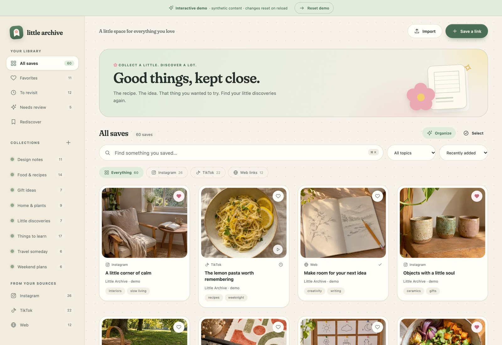

# Little Archive

**A little home for everything you saved.**

Little Archive is an open-source, self-hosted library for saved posts, videos, and links. Keep your original collections, add your own tags and notes, and rediscover things you meant to return to—all in a warm, uncluttered gallery.

Run one private instance on your Mac, Linux machine, or server. There is no project-operated account service, analytics endpoint, or required AI subscription.

**Status:** Development toward 1.0; no stable release published · **License:** MIT · **Architecture:** Python + SQLite + buildless web UI

**[Try the interactive demo](https://abdulmalikaltararwa-oss.github.io/little-archive/)** · [Mac setup and live acceptance](docs/mac-acceptance.md) · [Install your own instance](#quick-start-with-docker) · [Setup for local assistants](docs/operator-setup.md) · [Verification](docs/verification.md)

The public demo uses synthetic content and temporary page memory. Your private library runs in your own instance.

The first v1 foundation batch passed all 12 acceptance jobs on [`505b93b0`](https://github.com/abdulmalikaltararwa-oss/little-archive/actions/runs/43484644844): 117 Python tests, 65 extension/web tests, 3 harness tests, 39 authenticated browser cases, 11 cases using the built extension ZIP, real-model integration, native Mac/Linux recovery, both container architectures, and update/rollback. This batch adds browsing continuity, isolated contributor setup, redacted operator diagnostics, and protocol compatibility. The broader [v1 plan](docs/v1-product-plan.md) still includes product and public-project work plus direct live-account and Mac operator acceptance. See [the verification record](docs/verification.md) for exact evidence and limits.



*The interface shown above uses synthetic demo content. Read the [verification results and limits](docs/verification.md) for the tested release scope.*

## What you can do

- Browse a responsive gallery with a detail inspector and light/dark themes.
- Search titles, available source text, tags, summaries, and notes.
- Filter by platform, collection, tag, favorites, progress, and review state.
- Preserve source collections separately from your own local collections.
- Add links, edit notes, organize tags, and perform bulk actions.
- Import supported JSON, CSV/TSV, bookmark HTML, and saved-data ZIP files.
- Use an experimental Chrome extension to collect the current Instagram Saved or TikTok Favorites/collection view.
- Queue optional text categorization through your own Ollama service, then accept or dismiss its suggestions.
- Upload local preview images, export your records, and download a consistent backup.

### Current boundaries

Development is continuing toward the first stable 1.0 release, with acceptance tracked in the [release gates](docs/release-gates.md). The extension is **experimental** and scans a source view you explicitly select. It does not promise to discover every collection, overcome a login challenge, recover deleted posts, or keep importing after Chrome closes. Platform layouts can change.

Link import is distinct from media understanding. A caption-based suggestion is based on the available caption; the application does not claim to have watched a video. Full video downloads, speech transcription, OCR, mobile share extensions, and semantic search are not included in the current build.

The instance has **one owner account**. It can organize multiple source-account labels, but it is not a multi-user hosted service. Keep the instance private unless you deliberately deploy it behind HTTPS and suitable access controls.

## Quick start with Docker

Requirements: Docker with Compose, and Python 3 for the setup helper.

```sh
git clone https://github.com/abdulmalikaltararwa-oss/little-archive.git
cd little-archive
python3 scripts/setup.py
docker compose up -d --build
```

The setup helper prepares private local configuration and an owner password. Open `.env` locally in a text editor to retrieve that password; it is no longer printed in terminal logs. Keep it out of chats and issue reports. Open **http://localhost:8787** and sign in. The default Docker configuration binds the service to the local machine.

Use **Add link** for your first item, import a supported file, or explicitly load the synthetic demo library to explore the interface. Demo content is not loaded automatically.

See [self-hosting](docs/self-hosting.md) for native Python setup, HTTPS deployment, updates, and the optional model service.

### Predictable setup and diagnostics

For an installed source/native Python environment, the new operator commands can preview configuration creation and diagnose it without exposing credentials:

```sh
.venv/bin/python -m server.cli setup --dry-run --json
.venv/bin/python -m server.cli setup --apply --json
.venv/bin/python -m server.cli doctor --json
```

Existing configuration is preserved. Doctor does not open or initialize the library database, and makes no network requests by default. Add `--check-ai` for bounded Ollama version/model-inventory checks; this does not run inference or establish that processing is local. The [operator and assistant guide](docs/operator-setup.md) explains prerequisites, result codes, environment precedence, and supported scope. These commands do not yet provide the planned packaged Mac installer or model-download wizard.

## Explore the synthetic demo

The standalone demo lets you try the gallery, search, collections, notes, and favorites without setting up a server or account. Its original sample content and any edits live in the current page and reset when you reload. Real imports, account connections, AI, image uploads, and backups require your own instance.

From a local copy of this repository:

```sh
python3 scripts/build_demo.py
python3 -m http.server 8090 --bind 127.0.0.1 --directory dist-demo
```

Open **http://localhost:8090/**. The builder copies a small, explicit set of frontend files into `dist-demo`; it does not include the Python server or any private library. The demo's assets use relative paths, so it can also run at a GitHub Pages project subpath such as `/little-archive/`.

See [publishing the source and demo](docs/publishing.md) for repository creation and the included manual Pages workflow. Publish only `dist-demo` as the demo artifact. GitHub Pages hosts this static preview; a working private instance needs the self-hosted server described above.

## Install the companion extension

1. Open the app's settings and create an import token. Copy it when shown; it is not displayed again.
2. In Chrome, open `chrome://extensions`, enable Developer mode, choose **Load unpacked**, and select this repository's `extension` directory.
3. Open the extension and enter your instance URL and token. Remote instances require HTTPS; a loopback instance may use HTTP.
4. Open the intended Instagram Saved or TikTok Favorites/collection page, confirm the source-account label, and provide the exact collection name when applicable.
5. Start the current-view import. Keep the source tab available. Read its coverage result before assuming the scan was complete.

The token can import observations; it does not grant general access to your notes or settings. Revoke it from the app when no longer needed. The extension does not request platform passwords or export platform session cookies.

Read [import formats and coverage](docs/importing.md) for supported file shapes and the difference between a finished scan and a complete inventory.

## Optional AI

AI is optional. Search, browsing, manual organization, imports, and exports work without it.

Configure both `LA_OLLAMA_URL` and `LA_OLLAMA_MODEL` on the server to enable text suggestions. Use a model already downloaded into your own Ollama service. Nothing is sent to a model automatically just because it is configured; categorization is an explicit action.

Classification supports individual saves, all saves matching a filter, or the entire non-archived library. The server resolves the full matching inventory independently of which gallery pages have loaded. Unchanged work already queued, running, or completed is not duplicated. Queued/running work can be cancelled, and failed or cancelled jobs can be retried using current item evidence. Cancelling an in-flight model request discards its eventual result; the model may continue computing until that request finishes.

Generated suggestions stay in a review flow. They have no tools or authority to change source collections or overwrite your notes. Review their interpretation of untrusted source text before accepting it. An accepted suggestion remains a source-limited interpretation, not an independent fact check.

## Your data

- SQLite stores records, source memberships, annotations, and import history.
- Uploaded thumbnails are stored with your instance and included in backups.
- Remote previews are disabled initially. Enabling them lets your browser contact the recorded image hosts; those hosts may see the request.
- The application does not fetch arbitrary saved URLs on the server.
- The extension sends collected observations only to the instance you configure.
- A JSON export preserves the library's portable record structure; a backup also carries local image assets.

Read [privacy](docs/privacy.md), [security](SECURITY.md), and [backup and restore](docs/backup-restore.md) before exposing an instance on a network or moving private library data.

## Development

The frontend and extension are plain ES modules. Use the isolated contributor workspace so development does not reuse personal configuration or saved content:

```sh
python3 -m venv .venv
.venv/bin/pip install -r requirements.txt
.venv/bin/python scripts/dev.py --prepare --seed
.venv/bin/python scripts/dev.py
```

Open **http://127.0.0.1:8788**. Retrieve its private password locally from `work/contributor-dev/owner-password.txt`. This launcher binds only to loopback, ignores production `.env`/`LA_*` settings, and preserves its synthetic library on restart. From an activated environment, `npm run dev -- --seed` is equivalent. See [contributing](CONTRIBUTING.md) for inspection, bounded cleanup, and locked JavaScript test setup.

In a separate terminal, run the checks:

```sh
.venv/bin/python -m unittest discover -s tests -v
node --test extension/tests/*.test.mjs
node --test web/*.test.mjs
```

See [architecture](docs/architecture.md), [the API contract](API_CONTRACT.md), and [contributing](CONTRIBUTING.md). Do not commit your `.env`, local database, exports, or source-account data.

## Project direction

The [22-deliverable v1 plan](docs/v1-product-plan.md) covers guided importing, personal categories, Mac delivery, local AI setup, recovery, accessibility, and open-source maintainability. See [the roadmap](docs/roadmap.md) for the distinction between implemented capabilities and planned work.

Little Archive is independent software. Platform names describe compatible import contexts; they do not imply affiliation, endorsement, or authorization. Use it with content and access you are entitled to use.

## License

[MIT](LICENSE). Copyright © 2026 Little Archive contributors. The license covers this project's code and original assets, not third-party saved content.
