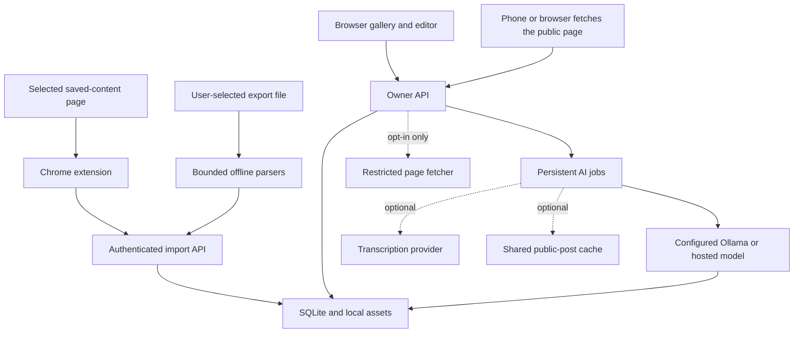

# Architecture

Little Archive is a single-owner web application with a small self-hosted server, SQLite storage, a buildless frontend, and an optional Chrome extension.

## Server

Python/FastAPI serves both static frontend assets and `/api`. The application owns the database and performs authenticated, bounded operations. SQLite is appropriate for this one-owner instance.

Every owner route resolves one library from the request's credential: the cookie session, a full-access device token for native clients, or, in the opt-in [hosted mode](hosted-mode.md), a verified identity-provider token. Hosted mode gives each account its own SQLite file and thumbnail folder rather than sharing tables, so the queries below are the same in both modes. That design has automated tests but no independent security review yet.

The storage layer separates source relationships, editable annotations, import receipts, and AI suggestions. A source refresh must not overwrite notes or remove a saved item merely because a scan missed it. Batch identity and payload checks make retries idempotent.

## Frontend

Plain HTML, CSS, and ES modules keep the application easy to inspect and serve. The UI uses the same-origin API and CSRF-protected owner session. Source strings are untrusted text, not HTML to execute. No externally hosted runtime scripts or fonts are required.

The gallery, filters, inspector, settings, and import activity use real API state. The synthetic demo library exists for exploration and screenshots; it does not claim real source access.

## Extension

The Manifest V3 extension is a collector, not a second library. A user starts a scan in the intended saved-content view. Observations enter a bounded persistent outbox, then travel to the configured server using an import-scoped credential.

Source extraction and server communication are separate concerns. Content scripts should never receive arbitrary network-fetch authority or the owner's session. The service worker validates message senders, destination, run state, and source scope.

## File parsers

`server/importers.py` returns normalized observations plus warnings. It does not write the database, extract ZIPs to disk, or fetch URLs. (Reading a saved link's page is a separate, opt-in feature; see the understanding layer below.) Platform archives are parsed through recognized saved/favorite sections. Unknown nested account data is not recursively harvested.

Portable Little Archive JSON is distinguished from platform export data so the application can restore annotations intentionally while protecting them during ordinary source refreshes.

## Classification

`server/classifier.py` is the stable single-item entry point. Over the shared provider interface in `server/enrich/understanding.py` it prepares bounded text evidence, sends a schema-constrained request to the operator-configured service (Ollama, or the optional hosted Gemini provider), validates the complete response, and returns a suggestion. The model has no tools and cannot modify collections or annotations directly.

The worker persists job state. Generated suggestions remain reviewable, and a failure must not erase existing user data. Text-only evidence cannot establish full image or video understanding.

Queue scope is resolved on the server: selected IDs, all matching filters, or the whole non-archived library. Gallery pagination does not limit it. A fingerprint covers the classifier's actual bounded evidence, model, endpoint, prompt, and response schema. Identical work already queued, running, or completed is not duplicated. Job history is paginated while state counts cover the complete history.

Cancellation marks queued/running jobs durably. The worker checks that a job is still active before writing its result, so a request that finishes after cancellation cannot revive it. Failed/cancelled jobs can be requeued from current item evidence. Acceptance rechecks the evidence fingerprint and rejects stale suggestions; suggestions do not become annotations merely by completing inference.

## Understanding layer

`server/enrich/` turns a saved link into something with a title, summary, topics, a suggested folder and, where useful, a transcript. It is documented in [Understanding saves](understanding.md); this is how it fits the rest.

- **Reading a page** is a pure function (`extract.py`): HTML or oEmbed JSON in, a normalised record out. It is fed by the client (extraction or raw HTML) or, only when enabled, by `netfetch.py`, a fetcher that resolves and validates every address, pins the connection to it, and limits redirects, size, time and content types.
- **Storing what was learned** (`service.py`) fills empty fields, keeps a re-encoded local cover and the caption text, and records transcripts as evidence of a new kind. It adds two tables (`item_enrichment`, `enrich_usage`) through an additive, idempotent schema (`schema.py`) that is separate from the core one; restore accepts a backup with or without them. Single-item reads carry a derived `enrichment` summary through a small hook on `Store.get_item`.
- **Understanding** goes through one provider interface (`understanding.py`) with an Ollama and a Gemini implementation. `classifier.py` remains the stable single-item entry point over the same code. `analysis.py` prepares public-only or full evidence, applies the optional cache, batches calls, retries a failed item alone, and meters usage.
- **Transcribing** (`transcribe.py`) is a second provider interface (Groq Whisper). A rule decides whether a transcript is worth having; making one automatically is an operator setting, and a deep read is always explicit.
- **The worker** (`worker.py`) extends the durable `ClassificationWorker`: the same queue, cancellation, restart recovery and review flow, with batch claiming, a transcript-first step for deep reads, and result writing that still checks the job is active and the evidence unchanged.
- **The shared cache** (`cache.py`) is a separate SQLite file with per-kind field allowlists, keyed by canonical URL and a hash of the analysed public text.
- **Metering** (`usage.py`) reports what each tier used through one hook and keeps local counters.

Evidence labels (`text-only`, `caption-based`, `transcript-based`) are computed from the input. A text model is never presented as having watched a video.

## Network destinations

Ordinary app browsing uses the configured instance. Extension imports use that same instance. Optional classification uses the configured model endpoint, which for the hosted provider is Google's Gemini API and receives post text. Optional transcription sends a post's audio to Groq. Optional server page reading contacts the saved URL's host (and YouTube/TikTok oEmbed, the cover and media hosts it names), from the server's address, through the restricted fetcher; it is off by default. Optional remote previews use the browser to contact recorded media hosts. Opening an original post opens its source URL.

There is no built-in application telemetry destination. Dependency installation and container/model downloads are separate operational network activity.

## Release verification

Tests cover parser boundaries, authentication, application mutations, idempotency, and classifier validation as implemented. The understanding layer adds fixture-driven extractor tests (including hostile input), fetcher tests with injected DNS and HTTP, provider tests against fake HTTP servers, and API tests of the whole pipeline. None of them touches the network or a real model; the hosted Gemini and Groq request shapes follow their published references and were not exercised against the live services. Pure extension tests exercise its normalization and state logic. The [manual release-validation workflow](../.github/workflows/release-validation.yml) adds real backend browser flows, packaged-extension fixtures, hardened AMD64/ARM64 recovery, native Linux/macOS setup and recovery, and actual model inference checks. Each must have a recorded passing execution before being counted as verified. Passing fixture tests does not establish live compatibility with every platform layout, and mocked inference tests do not benchmark model quality. The [release gates](release-gates.md) keep these scopes separate.
