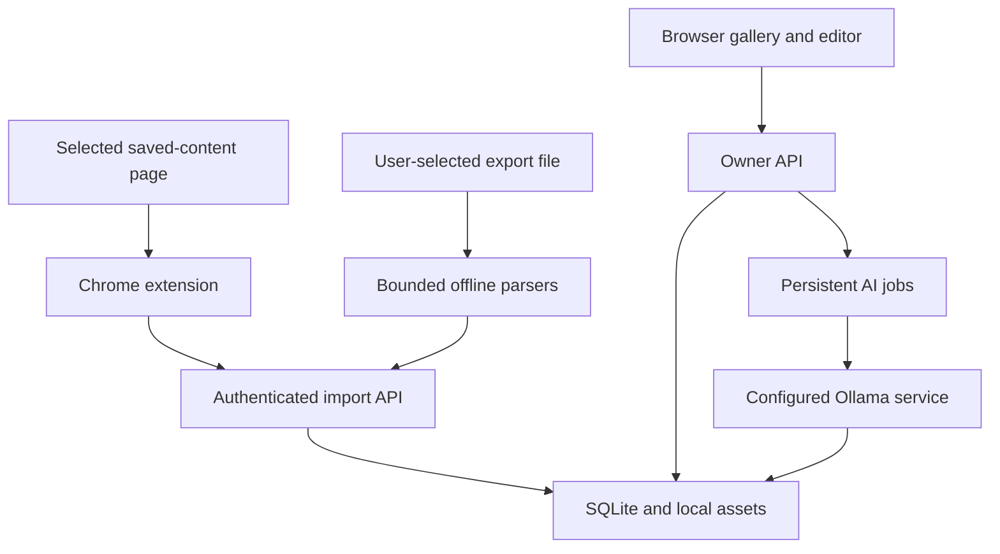

# Architecture

Little Archive is a single-owner web application with a small self-hosted server, SQLite storage, a buildless frontend, and an optional Chrome extension.

## Server

Python/FastAPI serves both static frontend assets and `/api`. The application owns the database and performs authenticated, bounded operations. SQLite is appropriate for this one-owner instance.

Every owner route resolves one library from the request's credential: the cookie session, a full-access device token for native clients, or, in the opt-in [hosted mode](hosted-mode.md), a verified identity-provider token. Hosted mode gives each account its own SQLite file and thumbnail folder rather than sharing tables, so the queries below are the same in both modes. That design has automated tests but no independent security review yet.

The storage layer separates source relationships, editable annotations, import receipts, and AI suggestions. A source refresh must not overwrite notes or remove a saved item merely because a scan missed it. Batch identity and payload checks make retries idempotent.

## Frontend

Plain HTML, CSS, and ES modules keep the application easy to inspect and serve. The UI uses the same-origin API and CSRF-protected owner session. Source strings are untrusted text, not HTML to execute. No externally hosted runtime scripts or fonts are required.

The gallery, filters, inspector, settings, and import activity use real API state. The synthetic demo library exists for exploration and screenshots; it does not claim real source access.

## Extension

The Manifest V3 extension is a collector, not a second library. A user starts a scan in the intended saved-content view. Observations enter a bounded persistent outbox, then travel to the configured server using an import-scoped credential.

Source extraction and server communication are separate concerns. Content scripts should never receive arbitrary network-fetch authority or the owner's session. The service worker validates message senders, destination, run state, and source scope.

## File parsers

`server/importers.py` returns normalized observations plus warnings. It does not write the database, extract ZIPs to disk, or fetch URLs. Platform archives are parsed through recognized saved/favorite sections. Unknown nested account data is not recursively harvested.

Portable Little Archive JSON is distinguished from platform export data so the application can restore annotations intentionally while protecting them during ordinary source refreshes.

## Classification

`server/classifier.py` prepares bounded text evidence, sends a schema-constrained request to an operator-configured Ollama service, validates the complete response, and returns a suggestion. The classifier has no tools and cannot modify collections or annotations directly.

The worker persists job state. Generated suggestions remain reviewable, and a failure must not erase existing user data. Text-only evidence cannot establish full image or video understanding.

Queue scope is resolved on the server: selected IDs, all matching filters, or the whole non-archived library. Gallery pagination does not limit it. A fingerprint covers the classifier's actual bounded evidence, model, endpoint, prompt, and response schema. Identical work already queued, running, or completed is not duplicated. Job history is paginated while state counts cover the complete history.

Cancellation marks queued/running jobs durably. The worker checks that a job is still active before writing its result, so a request that finishes after cancellation cannot revive it. Failed/cancelled jobs can be requeued from current item evidence. Acceptance rechecks the evidence fingerprint and rejects stale suggestions; suggestions do not become annotations merely by completing inference.

## Network destinations

Ordinary app browsing uses the configured instance. Extension imports use that same instance. Optional classification uses the configured model endpoint. Optional remote previews use the browser to contact recorded media hosts. Opening an original post opens its source URL.

There is no built-in application telemetry destination. Dependency installation and container/model downloads are separate operational network activity.

## Release verification

Tests cover parser boundaries, authentication, application mutations, idempotency, and classifier validation as implemented. Pure extension tests exercise its normalization and state logic. The [manual release-validation workflow](../.github/workflows/release-validation.yml) adds real backend browser flows, packaged-extension fixtures, hardened AMD64/ARM64 recovery, native Linux/macOS setup and recovery, and actual model inference checks. Each must have a recorded passing execution before being counted as verified. Passing fixture tests does not establish live compatibility with every platform layout, and mocked inference tests do not benchmark model quality. The [release gates](release-gates.md) keep these scopes separate.
